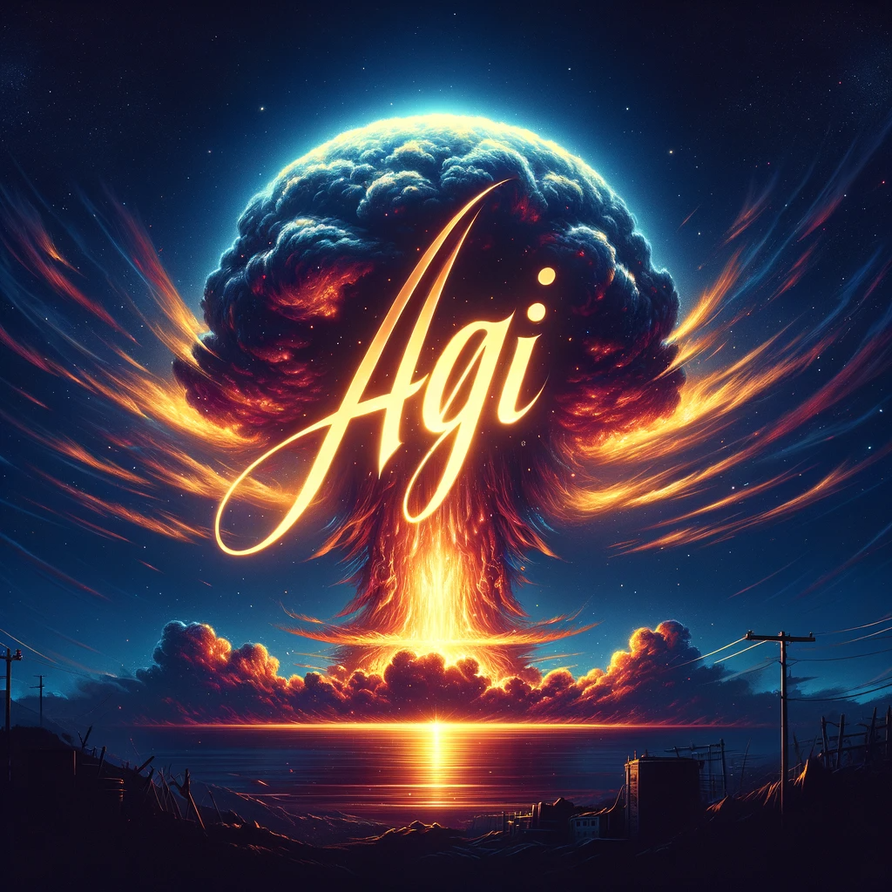

# A Blueprint for AGI: Bridging the Gap Between Open and Closed Systems

In the ever-evolving landscape of Artificial General Intelligence (AGI), the debate between open and closed systems has become a focal point. In this article, we explore the nuances of this debate and propose a novel approach that embraces the merits of both perspectives.

**The Need for Transparency**

First and foremost, the need for transparency in AGI deployment cannot be overstated. Openness, often championed by visionaries like George Hotz and Emad Mostaque, envisions a world where AGI is freely accessible to everyone. This vision hinges on the idea that openness fosters innovation and empowers individuals to harness the full potential of AGI.

On the other side of the spectrum, organizations like OpenAI advocate for closed-source AGI with centralized oversight. Their concerns are rooted in the potential risks associated with unrestricted AGI access. It's a valid concern; after all, AGI, like any powerful tool, can be harnessed for both good and ill. The idea of centralized oversight is a safeguard against malicious use, but it does raise questions about control and who gets to make the decisions.

**The AGI Atomic Bomb Analogy**

The analogy between AGI and the atomic bomb is often invoked. However, it's essential to recognize that AGI is fundamentally distinct from an atomic bomb. The bomb can only cause destruction, while AGI has the capacity to both create and prevent destruction. It can unlock a world of opportunities for positive change.

The debate becomes even more intricate when we consider the nature of business incentives. Those operating within the framework of capitalism may not always prioritize ethical considerations. In a system driven by profit, the allure of AGI's capabilities might lead to less-than-ethical choices.

**A Third Way: Decentralized Oversight**

Our proposal bridges the gap between open and closed AGI systems. We call it "decentralized oversight," a framework where individual users and communities play a crucial role in ensuring AGI's responsible use.

In this model, your nearest neighbors, both on an individual and community level, become the watchdogs. Transparency is the linchpin of this system. Every AGI application must be transparent about its usage. This way, the community can keep an eye on how AGI is being employed.

The decentralized oversight protocol would be open for public scrutiny and run under a system where not just the user but also their closest neighbors have the ability to intervene. This safeguards against outliers who might misuse AGI and ensures that the majority's interests prevail. By relying on the inherent goodness of humanity, we can nurture the potential for good while minimizing the risks.

**Conclusion**

In conclusion, the debate over open and closed AGI systems need not be binary. We can harness the advantages of both approaches through decentralized oversight. This solution ensures transparency, accountability, and community-driven influence.

While George Hotz champions open source, and organizations like OpenAI advocate for centralized control, we propose a path that acknowledges the power of community and decentralization. AGI, like any powerful tool, should empower individuals to create and prevent, safeguarded by the watchful eyes of those in closest proximity.

This is not merely a choice between open or closed; it's a call for a balanced, transparent, and community-driven AGI future. In this path, we can navigate the complexities of AGI and ensure that its potential for good far outweighs any potential for harm.
