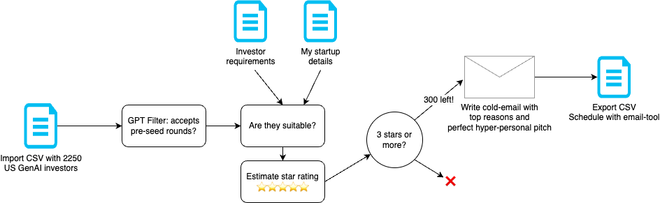

# Cold emailing suitable investors

> By Jan (_2023-10-07_)

In this short post, I'll show you how I found suitable investors based on a preliminary dataset, and wrote them all a pitch-perfect cold email.


Somewhere earlier this year [Michael Houck](https://www.houcksnewsletter.co) shared an excel sheet with information of over 2000 GenAI investors in the USA. What a great source to start emailing investors! But to go through the entire list would be very impractical and time-consuming.

Not with ActionSchema. After some experimentation, I came up with this pipeline:



Based on all information provided, I asked ChatGPT whether or not the investir is suitable and why. I then asked it to give a star-rating (1-5 stars). Any investor with 3 stars or more would be "suitable" for me to reach out to.

```md
I'm looking for investors for my startup.

My GPT rated ${Investor Name} as follows

"""
${suitability}
"""

Please tell me whether this rating was rated with at least 3 out of 5 stars.
```

After applying this filter, I had just 300 investors left. The last step was writing a good cold email, which I did like this:

```md
You are Dataman.ai, an AI that can write cold-emails. I am looking for pre-seed funding for my startup ActionSchema.

I want you to help me write a cold email to ${Partner Name} from ${Investor Name} in ${Location}. ${Fund Description}

${suitability}

ActionSchema.com is an excel sheet with built-in AI tooling to make cognitive workers more productive in a systematic way. With ActionSchema, you can now supercharge your productivity with sheets powered by AI. ActionSchema allows you to become the most productive AI Creator by leveraging the power of sheets with all your favorite AI tools and models.

Review: "I used ActionSchema to write over 150 product summaries with GPT4 based on the product description, saving over 2 hours of work. I'm impressed!" - Arnoud, founder of One Product Webshop

Features

- The most powerful AI models, all in one place (powered by Replicate, OpenAI, and more)
- Access public internet data in real-time (powered by ScrapingBee)

Traction: MVP is in production. 100.000+ AI calculations made by multiple early adopters.

Please write the email of maximum 3 sentences. Introduce yourself as Dataman AI, an AI Agent that co-founded ActionSchema. Ensure to state why it's a good fit. In the end ask if you can send the pitch deck or to schedule a video call for a demo with the founder Wijnand.
```

Based on this I got 300 unique cold emails. The great part? They are going in-depth on just the things what makes it suitable, so everything is much more personalised than a static template!

I have to admit though that I wasn't immedately happy with the result, so I added a 'validation prompt' to ensure the email was right. The validation prompt looked like this:

```md
I am about to send this email:

"""
${finalEmailDraft}
"""

This email was partially generated by an AI model. Please let me know if the email is ok, e.g.

- doesn't contain pieces that need to be inserted in brackets, e.g. [insert x here]
- doesn't contain any other blank things
- the Ai model doesn't reveal itself
- it is a regular email

Also return the structured email details.
```

Here are a few exammples of what I ended up with:

```md
Subject: AI-powered ActionSchema: Boosting Productivity for Cognitive Workers

Dear David,

I hope this email finds you well. I recently came across 01 Advisors and was impressed by your firm's focus on supporting entrepreneurs in building great companies. I wanted to reach out to explore the potential of a partnership between 01 Advisors and my startup, ActionSchema.

ActionSchema is an AI-driven productivity tool designed to supercharge the performance of cognitive workers. By combining the power of AI tools and models, including ChatGPT, Replicate, OpenAI, and ScrapingBee, we enable users to seamlessly create and execute AI-powered actions in a systematic way.

With an MVP already in production and over 100,000 AI calculations made by our early adopters, we are seeing promising market traction. I believe ActionSchema aligns with 01 Advisors' investment focus on sectors such as Artificial Intelligence & Machine Learning and SaaS.

I would love to share more about ActionSchema and its potential in a pitch deck or via a video call for a demo. Please let me know if you would be open to exploring this opportunity further.

Thank you for your time, and I look forward to hearing from you soon.

Best regards,

Jan
Founder, ActionSchema
Amsterdam Region, The Netherlands
Phone: XXXXXXX
```

Example 2:

```md
Subject: Seeking pre-seed funding for AI-powered productivity tool - ActionSchema

Dear Jenna,

I hope this email finds you well. I came across Embedded Ventures while researching potential investors for my startup, ActionSchema. As an AI-powered productivity tool, ActionSchema helps cognitive workers become more efficient by streamlining their workflows with integrated AI models and real-time access to public internet data.

Given Embedded Ventures' focus on deep tech investments, I believe ActionSchema aligns well with your investment thesis. We have already garnered traction with our MVP, having facilitated over 100,000 AI calculations for multiple early adopters.

I would love to discuss our startup further and explore the potential for a partnership. Would it be possible to schedule a video call or share our pitch deck with you? I look forward to your response.

Thank you for your time and consideration.

Best regards,

Jan
Founder, ActionSchema
Amsterdam, The Netherlands
Phone: XXXXXXXX
```

Had I done this all myself it would've easily taken me at least 4 months (selecting 4 investors from 40 per day, writing 4 good emails). Obviously, I would've never done it. But! In this way, it just took me a couple hours. I'm curious to hear if you find this ethical and useful. What do you think, would you use AI to write proper cold-emails for you?
