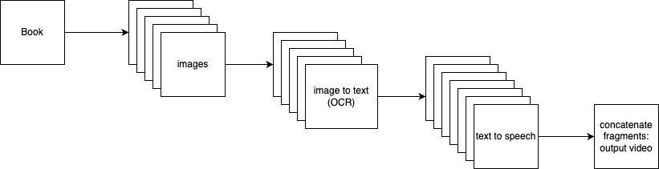
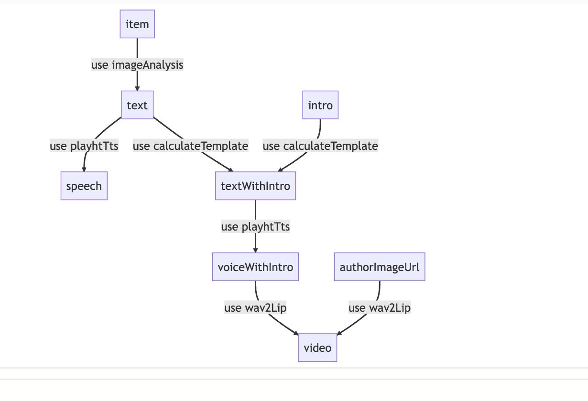
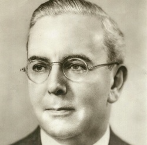

# Turning old texts into audiobooks with talking heads

Today I did something really cool. I was talking to a friend who had an idea to use AI to make audiobooks from old texts that are publicly available online. Great idea because who reads nowadays? Video content is the #1 way to consume nowadays, right?

The idea of an app would be to be able to consume great historical books and texts through video or as audiobooks. And now we can use AI to generate the voice, the video, everything!

So we came up with this pipeline:

Within about 5 minutes of clicking through some plugins, a proof of concept was done. We did not do an entire book (pdf) yet, but at least the idea works!

> A graphical overview of our ActionSchema can be seen here (this is automatically created by ActionSchema!) Important to note: the `item` is the picture of a single page of a book that we start with.

The input is a page of the book, an image of the author, and an intro-text.

The resulting video adds the intro to the contents of the page, and turns the authors photo into a talking head with moving lips. Pretty cool, huh?

The next steps, will be to:

- Clean up the OCR result to not include "sure here's the text from the image"
- Ensuring cut-off texts on line-breaks and new pages get recovered in a nice way. **NB: This is going to be difficult**
- This ActionSchema doesn't include turning a pdf into a list of images yet, nor does it concatenate the video fragments at the end. We can use [pdf-to-img](https://www.npmjs.com/package/pdf-to-img) and create a new plugin for this to make this possible!
- Concatenating can be an ffmpeg api easily. We should also make a plugin for this.
- Finally, we can turn this into an easy pipeline that turns an entire book (pdf) into a complete video, as described in the above pipeline.
- Automatically gather a good picture for the author.
- Add some sound effects in between the chapters.

Ultimately, a user could even import a boring pdf and get a watcheable video and/or audiobook to listen to. What a world we live in today!
