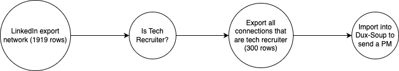

# Leveraging ChatGPT, DuxSoup and ActionSchema to send message all recruiters in my personal LinkedIn network


LinkedIn is great for networking but in the age of AI there are much more things possible, and LinkedIn doesn't provide it yet. I believe strongly in the ability to scale communication, which is why I've built [ActionSchema](https://actionschema.com). I believe that most people view this in a negative way since it's often seen as Spam, but I believe we can up the quality of communication at scale with AI, which can ultimately create value at higher scale than a regular human is capable of.


> When will we reach the top-right box?

In this post I'll show you how I've used AI to apply smart filters and send relevant messages to many people at once.

I've got 1919 people in my LinkedIn network but I haven't a clue how to reach out to them at scale. Since I'm out of runway for ActionSchema I decided I need to frind a freelance project in the Generative AI space. But how was I going to let my network know?

I found you can actually export your LinkedIn network into a CSV! Check [this out](https://www.linkedin.com/help/linkedin/answer/a566336/export-connections-from-linkedin). Great stuff!

Dux-Soup is a browser-plugin that can control LinkedIn for you on autopilot. We can easily do searches to send a list of people a connection request. But can we also do this based on people we already connected with? Yes! Great! But how do we ensure to only send a message to people that are "tech recruiter"? LinkedIn search allows you to search within your network, but it's not great as the terms aren't always mentioned in the people's title. If I search for "tech recruiter" I get just 42 results. That's not an option.

Let's do an GPT Filter on my network! This is the pipeline I've created:



In the `is tech recruiter` step, I've added this JSON-GPT prompt.

```md
I am looking at ${First Name} ${Last Name}'s profile on LinkedIn. ${First Name}'s position is ${Position} at ${Company}.

I am looking for a freelance tech opportunity, so please respond with yes if the person is doing anything with tech recruitment or Tech HR
```

JSON-GPT is a special adapation I've made for ChatGPT that allows it to respond with structured data. This way, I've asked it to respond with a boolean (`true` or `false`) so I can easily filter out the people that aren't relevant.

Running this prompt on my entire network (1919 rows) cost me €2,00 and took about 5 minutes with ActionSchema. Afterwards I was able to apply the filter (on `true`) and exported 300 recruiters from my personal network!

Importing this into Dux-Soup was a breeze. Important to note: your csv needs to have specific naming of the columns `Profile`, `First Name` and `Last Name` and the linkedin url needs to be exactly matching with `https://www.linkedin.com/in/*`. After that was settled, I could easily import the CSV with 300 recruiters into DuxSoup and run my camapign.

```md
Hey _FN_, I wanted to let you know I'm currently looking for a new freelance assignment, preferably in the GenAI space. My expertise lies in full stack app/web development and AI + Web scraping. I'm mostly interested in combining AI and webscraping, or projects that require prompt engineering.

Let me know if you know any opportunity that matches this!
```

This PM has been sent to a few recruiters now, and will be sent to all of them over the coming day. Pretty useful to be able to filter like this. I'll definitely use this more often. In a future post I'll explore how we can create even better filters by also including the work history, language, and location of a person and apply much more detailed filters on that.

_Originally this linked to an ActionSchema table with everything I did with my LinkedIn network, where you could upload your own network too. That table is no longer online._

> **Disclaimer**: Please beware that you don't get banned on LinkedIn when doing this! The discussed strategy is not without risk as it might be against linkedins policies. You are fully responsible for your own actions! Read more [here](https://support.dux-soup.com/article/90-warning-from-linkedin).
