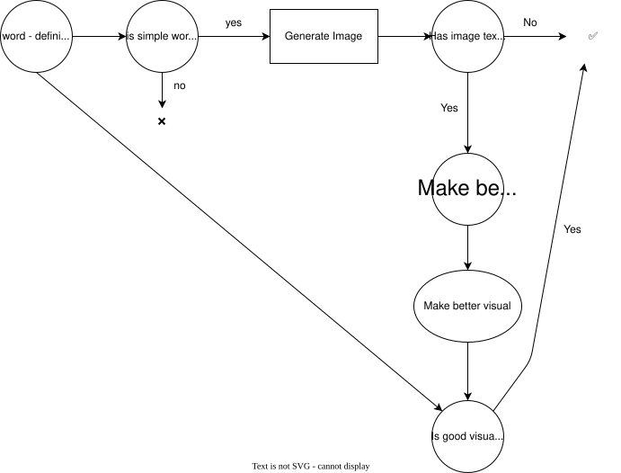
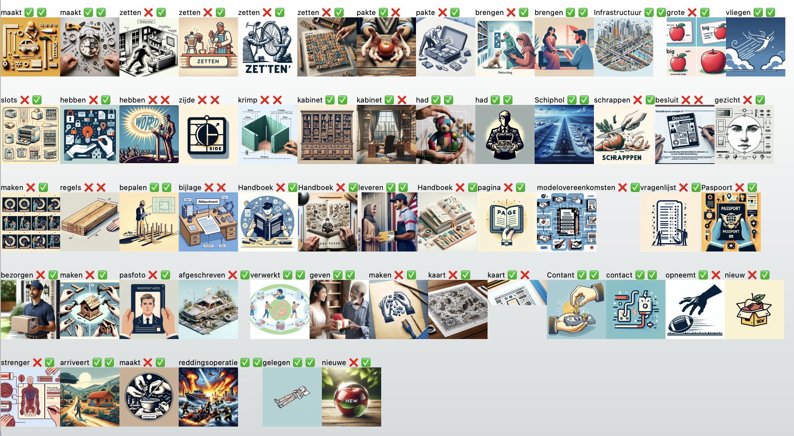
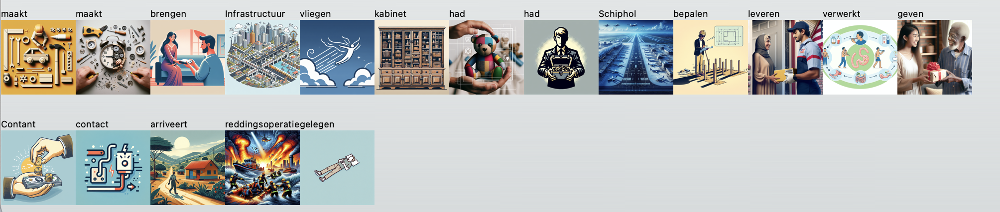

# How Tolkie used ActionSchema to generate beautiful graphics for low-literate website understanding

After presenting my work with ActionSchema at [AI Grunn](https://aigrunn.org) - an AI conference in Groningen - I came in contact with the founder of a startup named [Tolkie](https://tolkie.nl) - a startup that makes websites readable for low-literate people.

So far, they've already been using generative AI in their product quite a bit, especially for crafting the right definitions for an article. They were also experimenting with visualising words, but the results where not promising enough so far, so I offered them to have a better look at this by using ActionSchema: we did a pilot!

In our pilot we've tried multiple strategies to generate new simplified definitions, but most intererstingly, we've looked at a better way to generate high-quality images for words in the context of a definition.

## What made ActionSchema useful

For Tolkie, ActionSchema was useful because it allowed for quick trial and error, trying multiple prompt engineering strategies and comparing results side-by-side in the schema.

- Compare GPT-3.5-turbo with GPT4
- Compare different prompts with different prompt strategies: 0-shot, multiple-shot, super short prompts, and longer prompts where clear rules are defined.


> Trying and seeing results for multiple prompts side by side can be a real time-safer in the iterative process of prototyping!

## Diving into the image generation

The goal of our pilot was to find a better way for generating proper images that could be shown to low-literate people to improve understanding of the word. The biggest challenge with image generation for words in a provided context, was that not all words provided an accurate result.

So far - before the pilot - Tolkie succeeded to generate images for words that were pretty good in most cases, but they did not succeed in creating this in a 100% accurate way yet. As a result, the results were unusable as it required them to manually go over tens of thousands of pictures!

Within this pilot with ActionSchema, me and Jeroen (the founder of Tolkie), developed a strategy to get results with a near 100% accuracy. It was not the goal to create a nice image for all words, we needed to be sure that, if a word had a 'successful' image, it was REALLY good, so there would be no manual step needed afterwards, to verify.

Our strategy consisted of these parts:

1. providing a more **accurate definition** of the word
2. **Filtering out words** that are likely too hard to make an image for
3. **Generating the image** with Dall-E3
4. **Analysing the image** using GPT4-Vision afterwards, weeding out images that likely have mistakes.

## 1. Taking the best definition

The more accurate definition of the word depends on who it is for. For the low-literate person it was required to be a simply explained definition. However, in order to generate an image with a transformer model such as Dall-E3, a more detailed explicit definition worked better. In the end, this was the best prompt to generate the definition (Beware: the promopt is in Dutch!)

```
Leg het woord "${lemma}" in de betekenis van " ${definition} " in 1 korte zin uit aan een laaggeletterde.

## Belangrijk:
Geef alleen de uitleg van het woord, zonder een herhaling van de volledige input. Geef geen voorbeelden. Gebruik het woord "${lemma}" in de uitleg. Gebruik simpele woorden.
```

## 2. Filtering out words

Some words are hard to visualise. In order to get more accurate results, we decided to filter out a large section of words that we already knew were hard to visualise.

```
Neem dit woord: ${lemma}
Definitie: ${gpt35NewPrompt}

Gaat het hier om een tastbaar object of fysieke handeling?
```

This prompt, together with a JSONGPT prompt that parses it into a boolean, tells us if the word defines something in the physical domain. If not, we filtered it out.

## 3. Generating the image

For generating the image, we explicitly asked it this: `Visualise the word ${lemma}. ${gpt35NewPrompt}. Important: don't write any text. Style: friendly-colored simple drawing on a white background.`

It was important to be explicit about the style and that it should not write any text.

## 4. Analysing the image

In the final image, we noticed that some images still contained text, even after specifically asking it not to do this. Because of this, these images were unusable.

Luckily there are image analysis models. Before we'd have to work with [LLava13B](https://replicate.com/yorickvp/llava-13b), but ActionSchema has recently been updated to also support GPT4-vision: a much better model for image analysis.

In order to filter these errors out, I've added an image analysis prompt that tells me whether or not the image contains any letters/text. This works very well and for all text-containing images, I did a follow up prompt that did the visual description generation in a separate promopt (not directly in Dall-E3). This yielded a better description and ultimately an image without text.

- GPT4v `hasText` prompt: `Please tell me if you see any text in this image`
- JSON GPT has text boolean prompt: `Consider the result of my image analysis: '${hasText}'. Please tell me if the image contains text or not (based on the analysis) with a boolean` with result format `{ "hasText": boolean }`

Finally, I asked it if the image seemed good enough according to the original word and definition. Of course this is a very subjective question, but it may still filter out some false positives!

- GPT4v `isGoodImage` prompt: `This visual needs to depict " ${gpt35NewPromptEnglish} " . Is this well done?`
- JSON GPT boolean prompt: `Consider this image analysis: " ${isGoodVisual} ". According to the analysis, is the image effective?` with result format `{ "isGoodVisual": boolean }`

## Putting it all together

The flow can also be represented in a graph like below:



## Results

After running the prompts for all simple enough images (`isSimpleImage=true`) I got these results:



The two validators `hasTextBoolean` and `isGoodVisualBoolean` are shown with the two emojis respectively (❌ for invalid, ✅ for valid)

Ultimately, it seems Dall-E3 certainly still makes mistakes because there are a lot of results that contain text. But the validators resolve that: GPT4-V seems to accurately detect whether or not the image contains text. For the cases that `isGoodVisualBoolean` returned false, it also seems GPT4-v had a good case. These visuals were definitely less clear than others.

All in all I'm happy to see how well these GPT4-v validators work! However, the overall pipeline and especially up to making the image, can definitely be more improved. But for now, Tolkie can probably use the images containing two checkmarks. There aren't a lot, but the ones that are valid seem great to me.

> The valid ones:



## Conclusions

With ActionSchema we succeeded to generate more accurate images with an incredibly low error-rate, minimising the need for human approval upon generation.
