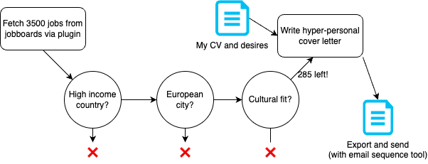
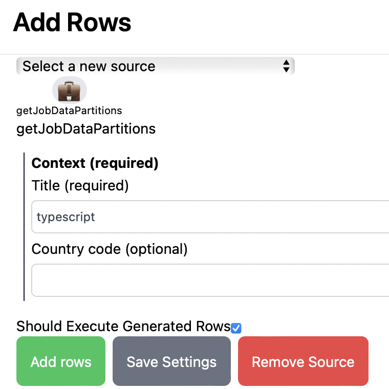
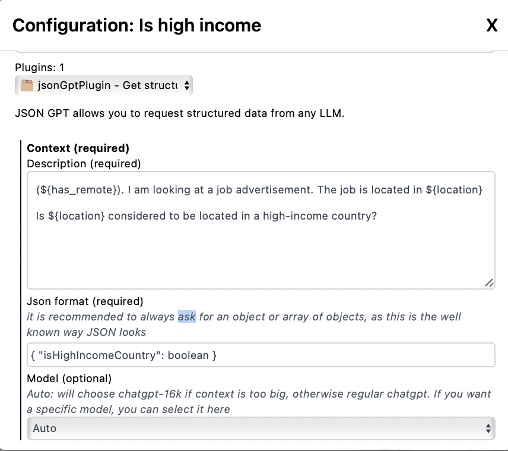
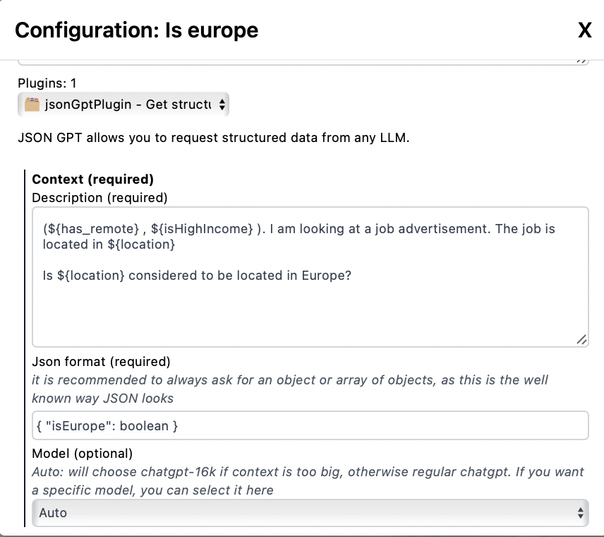
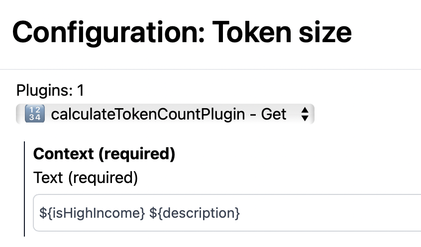

# Writing 285 amazing cover letters while hunting for remote jobs



> By Jan (_2023-10-07_)

Since the launch of ChatGPT, I've been building AI products non-stop. Unfortunately, nothing really came off the ground yet. That's the founders life! I know I'm onto something, I now I'm close. Fortunately, ActionSchema is now mature enough to help me on my jobhunt.

Let's try to find a permanent or freelance position, part-time or full-time. In this post I'll show you how I leverage the power of ActionSchema to create a hyperpersonalised filter on my needs, and then use ChatGPT to write me the perfect job cover letter.


## Fetching data from jobboards

I recently added this integration as an actionschema.com plugin after I found it on ProductHunt. It's an amazing API that has tons of job-listings with a big coverage of tech-jobs and remote-jobs. Big shout-out to [Job Data Api](https://jobdataapi.com) to make this possible!

I am searching for jobs in my expertise, which is React Native, Typescript, and Prompt Engineering. I don't have any specific country I want to work, so I'll search for the whole world.



Three searches like the above ended up with a total of 3500 jobs worldwide adhering to these criteria.

## Filtering on my personal criteria

Of course, I don't want to work everywhere. I want a decent salary, so let's filter for countries with a high-income country. JobDataApi doesn't provide this, but with ActionSchema it's not a problem!



I also later decided I acutally want it to be in Europe. Again, we can't select a continent easily, but ChatGPT knows which countries and cities are in Europe so no biggie!



After applying these filters on top of the `is_remote` filter that was already present in the API data, I found a total of 285 remote first, high-paying jobs from companies in Europe for my expertise.

## Ensuring my prompt didn't get too big

Before write a coverletter, let's check if the prompt wouldn't become too big. I here count the amount of tokens of the description of each job:



Fine! The biggest one is just a bit over 4000 tokens. Since the ChatGPT plugin uses `gpt3.5-turbo` by default, but goes to `gpt3.5-turbo-16k` if it's more than 4000 tokens, it's small enough. We can run all descriptions with our prompt with ease, as I think that my prompt and the generated result wouldn't be much more than double of the description. That means everything is below 16000 tokens, which makes it fit.

## The master prompt: writing the perfect coverletter

Now let's write the master prompt that writes me the perfect cover letter. I came up with this.

(Please note that I added the variables at the top; this is a little hack for now, because it will filter out all rows in which these variables resolve to false. Later, there will be a `condition` field for every plugin.)

```md
${isHighIncome} ${isEurope}

Consider this role:

"""
${description}
"""

Please write a good cover letter in which I, Jan, express interest in this role, and why I would be a good fit.

My expertise:

- More than 5 years freelancing full-time positions in react native and full stack typescript roles.
- Worked mostly for small startups and mid-size companies on innovative projects (Big companies from The Netherlands like InterGamma and Emesa, but also helped kick-off small startups like Dyme.nl)
- Studied AI and have been working on a stealth AI product for 2 years now. Lots of experience with AI tech and prompt engineering.
- I've lead a team of developers for a year at my own startup.
- I have experience mitigating complex problems in multi-disciplinary teams in big companies.

Selectively choose the right things to say based on the actual role and its required skillset and needs. Do not come up with anything specific about me that isn't mentioned above. Focus on why I'm interested in that role and the company.
```

It took me a little prompt-fine-tuning and trial and error before I got to this point, but this is what I ended up with. When I am fine-tuning, I usually only recalculate a few rows, so it doesn't cost too much tokens.

Finaly I was ready to generate 285 beautiful cover letters. I've read a few of them, and I'm very happy with the results. As requested, there isn't anything lied about my experiences in the cover letters, and the AI beautifully integrates my expertise and the companies needs to create a beautiful cover letter. What a world we live in...

_Originally this linked to the resulting ActionSchema sheet (15MB+). That sheet is no longer online._

Feel free to use this as an example or starting point for your own job-hunt!

## Sending in the applications

Unfortunately, sending in applications is still a manual process. There is no email available for the companies through this API. I tried to look up if I could somehow find the email (using the website and the google search plugin), but that didn't really work out. It's obvious as many big companies have all kinds of different departments and HR just uses platforms like lever and greenhouse.

Jobdataapi did provide a link to the site where you can apply for the job though, which is great. You need to still fill in a form for most applications, and upload your CV and stuff like that, of course, so this will cost me a couple of minutes each.

My next step will be to do this for a decent chunk of the 285 generated cover letters and get into interviews. Hopefully I can still pay my taxes in time.

<!-- todo: add "isCultureFit" and "isMarketFit" variables in which I can omit finance corporates  -->

## The results

Here are a few examples of the generated cover letters:

```md
Subject: Passionate Full Stack Developer with Expertise in React.js and Node.js

Dear Hiring Manager,

I am writing to express my sincere interest in the Full Stack Developer role at Software Mind Poland. With over 5 years of freelancing experience in full-time positions, specializing in React Native and TypeScript roles, I am confident that my skills and expertise make me a strong fit for your team.

Having worked on a multitude of innovative projects for small startups and mid-size companies, I have acquired a deep understanding of the intricacies and challenges involved in building cutting-edge software solutions. I am particularly excited about the opportunity to work on the SaaS ERP software dedicated to the construction industry that Software Mind is developing with its partner from Finland.

Throughout my career, I have gained invaluable experience in React.js and Node.js, making me well-equipped to contribute to your team's success. I possess a strong technical foundation and am capable of programming, designing, and implementing features with precision and efficiency. Moreover, my experience in collaborating closely with product owners and architects has honed my ability to deliver software solutions that meet both business and technical requirements.

While my expertise lies primarily in React.js and Node.js, I have also gained some basic experience with relational databases, as well as knowledge in AWS and microservices architecture. I am adept at using testing technologies such as JEST, React Testing Library, and Cypress, and I am also familiar with Kubernetes, Github, and Shell scripting. This diverse skill set enables me to contribute across various aspects of software development, from architecture design to CI/CD pipeline implementation and maintenance.

What truly sets me apart is my passion for innovative technologies. My background in AI, coupled with my ongoing work on a stealth AI product, has given me valuable insights into emerging trends and technologies. I am continuously seeking opportunities to expand my knowledge and stay ahead of the curve, which aligns perfectly with Software Mind's commitment to embracing emerging technologies.

Moreover, I am drawn to Software Mind's company culture, which promotes openness, respect, and a passion for creativity. The prospect of working in an international environment, collaborating with professionals who share the same dedication to excellence, and having the opportunity for personal growth and development is incredibly enticing to me. Additionally, your emphasis on flexibility, remote work options, and international business trips further reinforces my interest in joining your team.

In conclusion, with a proven track record in delivering high-quality software solutions, expertise in React.js and Node.js, and a genuine passion for innovative technologies, I am confident that I would be a valuable asset to Software Mind Poland. I would welcome the opportunity to contribute to your team's success and to collaborate with like-minded professionals who share a common vision.

Thank you for considering my application. I look forward to the possibility of discussing how my skills and experience align with Software Mind's needs in greater detail.

Yours sincerely,

Jan
```

Example 2:

```

Subject: Enthusiastic Full Stack Developer ready to take Agile Soul to the next level

Dear Hiring Team at Agile Soul – Software Mind,

I hope this letter finds you well. I am writing to express my sincere interest in the Full Stack Developer position at Agile Soul. With my extensive experience in React.js, Node.js, and my strong passion for innovative software development, I believe I would be an excellent fit for your team and contribute to the success of your SaaS ERP software dedicated to the construction industry.

Over the course of my career, I have accumulated more than 5 years of freelancing experience, primarily focusing on React Native and full stack TypeScript roles. Working with small startups and mid-sized companies, I have gained valuable insights into best practices and brought innovative ideas to life. Notably, I have had the opportunity to work with renowned Dutch companies like InterGamma and Emesa, as well as contributed to the inception of promising start-ups such as Dyme.nl.

One aspect that sets me apart is my educational background in AI, coupled with my two-year involvement with a stealth AI product. This experience has allowed me to delve deep into AI technologies, including prompt engineering and cutting-edge AI solutions. I believe that this expertise could greatly benefit Agile Soul's ongoing quest for cutting-edge software development.

Furthermore, as a seasoned developer, I have had the privilege of leading a team at my own startup. This experience has taught me the value of effective team collaboration and efficient problem-solving. I possess the ability to mitigate complex challenges within multi-disciplinary teams, ensuring the successful achievement of project goals. I am confident that I will be able to closely collaborate with your international group of professionals, embracing the Nordic work culture and contributing positively to your team dynamics.

Your job listing speaks to me on multiple levels. The opportunity to work with modern JavaScript technologies and cloud services aligns perfectly with my skill set. I bring with me an in-depth understanding of React.js, Node.js backend expertise, and a solid foundation in relational databases. Moreover, your mention of Google Cloud Platform, microservices architecture, and cloud deployment closely resonates with my experience. I have also worked extensively with NoSQL databases, testing technologies such as JEST and React Testing Library, and deployment orchestration tools like GitHub and Kubernetes.

More than just the technical aspects, I am captivated by Agile Soul's commitment to professional development and personal growth. Your offer of flexible employment and remote work, coupled with international projects and business trips, highlights your dedication to providing opportunities for growth and exposure to a diverse range of clients and cultures. In addition, your emphasis on fostering a non-corporate atmosphere and investing in well-being initiatives is truly commendable.

I am confident that my experience, technical proficiency, and dedicated work ethic will make me a valuable asset to the Agile Soul team. I am excited at the prospect of contributing to the continued success of your SaaS ERP software and collaborating with a group of talented professionals who share my passion for innovation.

Thank you for considering my application. I look forward to the opportunity to discuss how my skill set and experience can contribute to Agile Soul's ongoing success. Please find my attached resume for your review.

Yours sincerely,

Jan

```

## Conclusion and further work

Filtering through 3500 open jobs would be possible but very time consuming manually. The GPT filters on income and europe quickly trim this dataset down to just ±300 which saves loads of time.

A further filter on cultural fit would be very interesting. Also it would be useful to extract the required format for the form and create this, so we can apply to the job in a fully automated way while adhering to their format.

Nevertheless, this truly shows the power of systematic prompt engineering. Writing a single letter and filtering 1 out of 10 job offers would take a human being half a day with ease, so writing 300 would easily take half a year. Now it can be done in a matter of hours!
